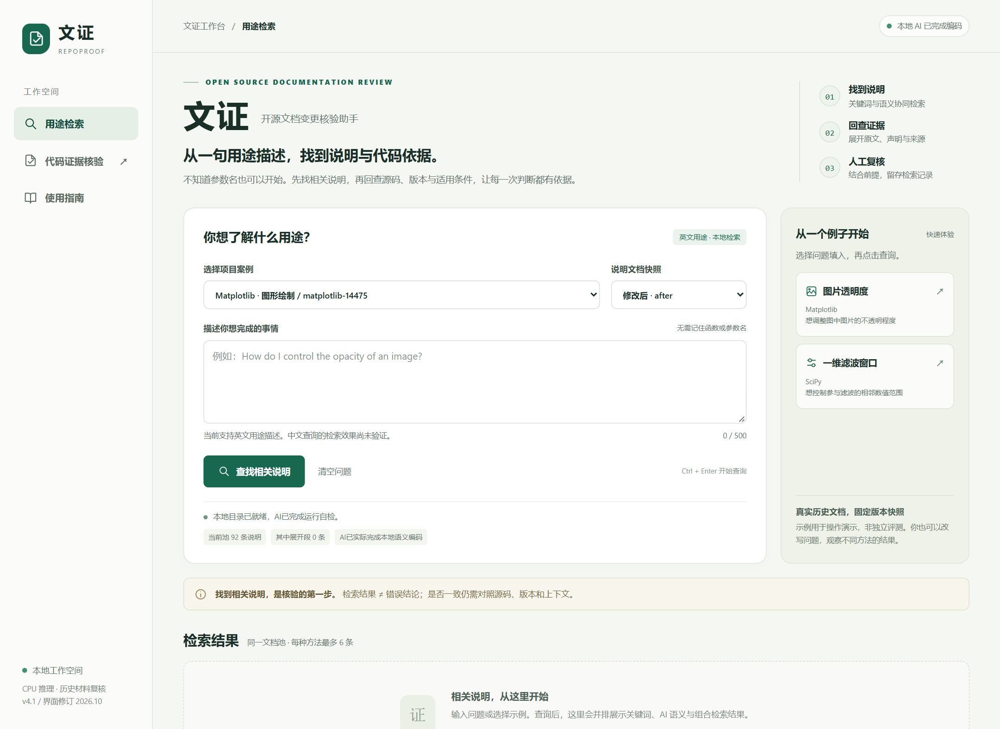
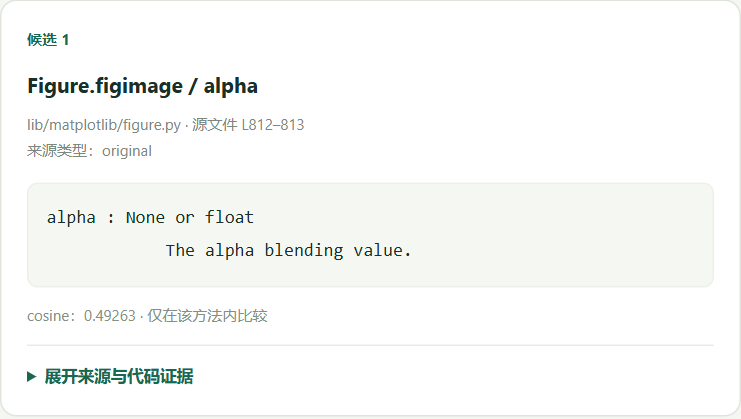
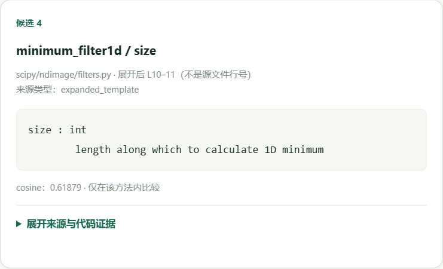

# 文证 开源文档变更核验助手

文证面向Python开源项目，将相关说明检索与代码证据核对放在同一工作流程中。
它支持BM25与本地MiniLM对照检索、默认值核对、受限模板展开、来源回查和结果导出。

## 评委从这里开始

1. 直接查看本页实际截图，以及[使用与复现说明](docs/使用与复现说明.docx)。
2. 在本仓库右侧 **Releases** 打开固定版本 **v4.1-ui-20261029**。
3. 下载 `repoproof-v4.1-ui-20261029.zip` 和 `dependencies-win312.zip`，按说明安装。
4. 报告PDF与演示MP4以报名平台上传件为准；下载包中的相对路径可用于复核证据。

本仓库中的src与templates用于源码浏览；完整运行时还需要Releases中的脚本、模型、固定样例和证据。
解压完整程序包后，双击 `打开评审导航.html` 可离线查看资料。
新的AI查询在接收者自己的电脑运行，不依赖作者电脑保持在线。

## 两个真实查询

“控制直接放在figure上的图片透明度”：AI语义第1条找到 `Figure.figimage / alpha`。

“控制一维最小滤波考虑的邻域大小”：AI语义第4条找到 `minimum_filter1d / size`，固定组合没有保留这一条。

## 结果如何理解

找到相关说明不等于确认文档错误。12条预先固定、由助手依据已见文档编写的用途开发题，
同6条候选预算下BM25命中9题，固定组合命中10题；不代表独立盲测、总体缺陷准确率或普遍优于BM25。
源码与说明不一致候选仍需人工复核，证据不足时保留待定。

## 环境与资源

已验证Windows x64、CPython 3.12、CPU推理；固定all-MiniLM-L6-v2 ONNX模型包含在完整程序包中。
26个锁定wheel另附离线依赖ZIP；Python安装器不在包内。安装后本地查询不需要API密钥。
第三方来源、版本及许可证在报告附录及程序包中保留。新增核心代码与模板采用[MIT许可](LICENSE)，适用范围见[许可范围说明](LICENSE_SCOPE.md)。
